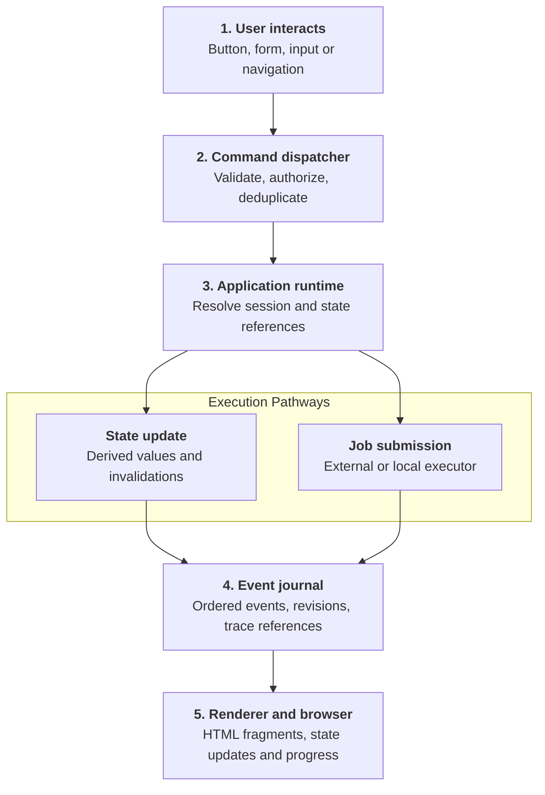

# RADUI Architecture Specification (Version 0.9.0)

RADUI is an open-source, Python-first frontend application framework designed for AI/ML/agents, analytics dashboards, and full-stack software.

---

## Architecture Flow

The architecture follows a strict 5-stage unidirectional execution lifecycle with SWR query caching, distributed multi-worker backends, and persistent layouts:

---

## Detailed Lifecycle Stages

### 1. User Interacts
- **Inputs & Controls**: Form fields, text inputs, textareas, selects, switches, radio groups, and chat inputs.
- **Triggers**: Buttons, action card approval/rejection triggers, and navigation links.
- **Transport**: Standard form submissions or asynchronous AJAX `fetch()` calls carrying signed `_csrf` tokens, `_gx_action_id` idempotency keys, and `_gx_view_id` route references.

### 2. Command Dispatcher
- **Validation**: Enforces strict payload bounds (`max_form_bytes`), character sets, and content types (`application/x-www-form-urlencoded`).
- **Authorization & Security**: Validates constant-time CSRF tokens (`secrets.compare_digest`), checks origin headers against base URLs, and blocks cross-site request forgery (`Sec-Fetch-Site`).
- **Deduplication & Idempotency**: Atomic in-memory action reservations (`_reserve_action`) prevent duplicate executions of identical `_gx_action_id` requests while caching and replaying identical responses.

### 3. Application Runtime
- **Identity Resolution**: Resolves signed browser session identity (`SessionMiddleware`) and optional user identification hooks (`user_id_resolver`).
- **Context Binding**: Allocates an isolated `StateContext` identifying the active session, user, and view scope.
- **Execution Dispatch**: Invokes registered Python async/sync command handlers with an injected `CommandContext`.

#### Pathway A: State Update
- Writes to typed `StateRef` references across four isolated scopes:
  - `view`: Scoped to `(session_id, view_id)`.
  - `session`: Scoped to `session_id`.
  - `user`: Shared across sessions of an authenticated `user_id`.
  - `app`: Global singleton process-wide state.
- Computes derived values, increments revisions, and calculates surgical component dependency invalidations.

#### Pathway B: Job Submission
- Asynchronously schedules background long-running workloads (`@app.job`) through the pluggable `JobBackend` (`LocalJobBackend` default).
- Enforces active concurrency capacity limits, cancellation guards, and progress event publication.

### 4. Event Journal
- **Ordered Events**: Ordered SSE journal publishing granular `invalidate` and `reset` events tagged with monotonic sequence numbers.
- **Revisions & Replay**: Maintains bounded in-memory event buffers to allow seamless client reconnection with `Last-Event-ID` or `since` parameters.
- **Trace References**: Telemetry captured by the `TraceCollector` recording latency, state diffs, command invocations, job progress, and errors.

### 5. Renderer and Browser
- **Surgical HTML Patches**: Server-side `HTMLRenderer` renders targeted HTML fragments for only invalidated components.
- **Progressive Delivery**: Browser applies DOM updates without full-page refreshes.
- **Native Motion Engine (`RADUI.motion`)**:
  - **FLIP Layout Interpolation**: Intercepts `applyPatches` and smoothly transitions DOM replacements using WAAPI.
  - **Spring Physics Solver**: Analytical damped harmonic oscillator driving 120fps hardware-accelerated animations (`transform`, `opacity`).
  - **Number Tweening**: Smooth animated number counting on metric updates (`animate_number=True`).
  - **Micro-interactions**: Declarative hover elevation and tactile tap depression.
  - **View Transitions**: Integrated with browser native `document.startViewTransition`.
  - **Accessibility**: Automatic enforcement of `prefers-reduced-motion`.
- **Client Script**: Lightweight vanilla client (`/_gx/client.js`) manages EventSource reconnects, form dispatching, job cancellation, optimistic rollbacks, and developer inspector drawer inspection.

---

## Enterprise & Resilience Extensions (0.6)

### 1. SQLite WAL Job Backend (`SQLiteJobBackend`)
- Durable, file-backed job persistence using standard library `sqlite3` with `PRAGMA journal_mode=WAL;`.
- Recovers safely from server crashes and process restarts without losing job logs, progress, or returned result payloads.

### 2. Built-in Auth & Role-Based Access Control (RBAC)
- Role-based decorators: `@app.command(require_auth=True)`, `@app.command(require_role="admin")`, `@app.require_auth`, `@app.require_role(...)`.
- First-class `User` and `RBACPolicy` models with inherited permissions and contextual guards.

### 3. Optimistic UI Updates & Automatic Rollback
- Forms and triggers marked with `optimistic=True` apply instantaneous local state while awaiting network resolution.
- Automatically reverts to snapshot on network failure or server rejection.

### 4. Scoped GenerativeSlot Mutations
- Dedicated sub-renderers and targeted slot patching for streaming AI responses without re-rendering parent tree nodes.

---

## Complete Frontend & Enterprise Architecture (0.7.0 Final)

### 1. Global Command Palette (`Ctrl+K`)
- Native modal dialog with fuzzy keyboard search filtering, arrow navigation, and instant command/page triggers.
- Provides immediate keyboard accessibility for developers and enterprise operators.

### 2. Design System & Theming Engine (`Theme`)
- Token-based theming architecture compiling declarative palettes (`primary`, `surface`, `bg`, `text`, `radius`) directly to CSS custom properties.
- Dynamic runtime theme switching via `ThemeToggle` component with client-side event dispatching and `localStorage` persistence.

### 3. Responsive Breakpoint Layout Engine
- Declarative column dictionaries (`columns={"sm": 1, "md": 2, "lg": 4}`) compiled into responsive CSS custom properties (`--gx-cols-{bp}`).
- Zero JavaScript overhead on resize; handled directly by modern browser CSS grid media queries.

### 4. Reflection-Based Model Forms (`form_from_model`)
- Introspects Pydantic model schemas and automatically synthesizes fully-typed RADUI Forms.
- Auto-generates type-safe form controls (`Checkbox` for bools, `Select` for Enums, `Textarea` for long text, number inputs for numeric fields).

### 5. High-Performance Virtualization (`VirtualList`)
- Windowed viewport slicing algorithm maintaining steady 60fps scrolling over 50,000+ items.
- Minimal DOM node footprint using pure CSS translateY positioning inside sized spacer elements.

### 6. Declarative Testing Harness (`TestHarness`)
- In-memory headless test runner for rendering component trees, extracting pre-filled forms and CSRF tokens, and dispatching command interactions without spinning up real browsers.

### 7. Micro-Frontend Embedding (`/_gx/embed.js`)
- Universal `<RADUI-view>` Web Component wrapper allowing RADUI views to be seamlessly mounted within React, Angular, Vue, or legacy enterprise web portals.

---

## Distributed Hardening & Advanced Routing (0.8.0 Final)

### 1. Dynamic Routing & Signature-Driven Path Injection
- Path parameter pattern matching (`/users/{user_id}`, `/orgs/{org}/repos/{repo}`).
- Auto-extracts URL path segments and injects them directly into typed Python page handler arguments.
- Route-level security guards: `@app.page("/admin", require_auth=True, require_role="admin")` blocking unauthenticated or unpermitted access with standard 401/403 responses.

### 2. Pluggable State Storage Architecture (`StateBackend`)
- Decouples reactive state management from process memory.
- `InMemoryStateBackend`: Ultra-low-latency in-memory dictionary for single-process local development and unit testing.
- `SQLiteStateBackend`: Durable file-backed ACID store running in SQLite WAL mode. Permits multiple Uvicorn workers and container restarts to read and write shared `user`, `session`, and `app` state without partition divergence.

### 3. Component-Level Error Boundaries (`ErrorBoundary`)
- Wraps arbitrary visual subtrees in an isolated execution sandbox.
- Intercepts render exceptions and displays localized error cards with customized failure messages and [Retry] buttons without crashing the overall view or dashboard.

### 4. Modal Focus Trap & Accessible Keyboard Management
- Traps keyboard `Tab` cycling strictly inside open modal dialogs to comply with WCAG 2.2 AA accessibility standards.
- Saves previously active element and restores focus upon modal dismissal (`Escape` or backdrop click).

### 5. Client Connection State & Offline Awareness
- Native browser `online`/`offline` listener and SSE EventSource state monitor.
- Automatically surfaces a non-intrusive floating connection banner (`.gx-connection-banner`) during network drops and dismisses it upon reconnection.
