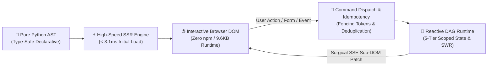
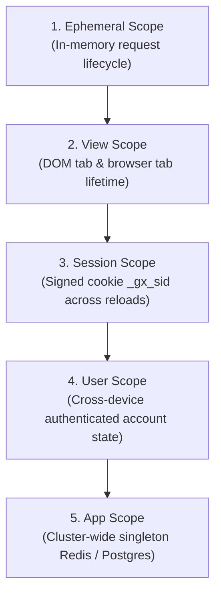
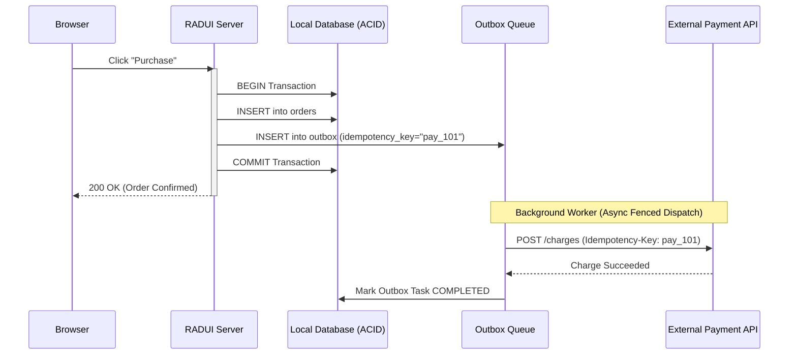

# RADUI — Reactive Application Development User Interface (v1.0.0)

<div align="center">

```
   ██████╗  █████╗ ██████╗ ██╗   ██╗██╗
   ██╔══██╗██╔══██╗██╔══██╗██║   ██║██║
   ██████╔╝███████║██║  ██║██║   ██║██║
   ██╔══██╗██╔══██║██║  ██║██║   ██║██║
   ██║  ██║██║  ██║██████╔╝╚██████╔╝██║
   ╚═╝  ╚═╝╚═╝  ╚═╝╚═════╝  ╚═════╝ ╚═╝
   
   REACTIVE APPLICATION DEVELOPMENT USER INTERFACE
```

**The Python-First Reactive Engine for Enterprise Dashboards, Autonomous AI Agents & Real-Time Web Apps**

[](https://www.python.org/)
[](LICENSE)
[](tests/)
[](benchmarks/)
[](#-architectural-principles)
[](#-installation--packaging-extras)

[🚀 60-Second Quickstart](#-quickstart-in-60-seconds) •
[✨ Interactive Showcase](#-interactive-feature-tours) •
[📊 Benchmarks](#-verified-performance-latency-6-tier-benchmark-suite) •
[🧩 Component Reference (68)](#-interactive-component-explorer-68-built-in-primitives) •
[🛠️ CLI Reference (45)](#-developer-cli-toolkit-45-commands) •
[🏛️ Architecture & ADRs](#-architectural-decision-records-adrs) •
[💡 Interactive FAQ](#-interactive-developer-faq)

</div>

---

## ⚡ Live Terminal Preview

```ansi
[radui] Starting RADUI v1.0.0 Server 🚀
[radui] Environment: Production | ASGI 3.0 Engine | Python 3.12.10
[radui] Registered 68 AST Components | 12 Route Handlers | 45 CLI Commands
[radui] ⚡ In-Memory AST Compilation:   0.039 ms (Median)
[radui] ⚡ HTML Stream Serialization:   0.038 ms (Median)
[radui] ⚡ Sub-DOM Reconciliation Diff: 0.168 ms (Median)
[radui] ⚡ SSE Wire Patch Delivery:     0.007 ms (Median)
[radui] 🛡️ Zero JavaScript Build Step | Zero npm dependencies | 9.6 KB Gzip Runtime
[radui] 🌐 Serving live dashboard at: http://localhost:3000
[radui] 🔍 Inspector Control Plane:    http://localhost:3000/_gx/inspect (Ctrl+Shift+I)
```

---

## 🌟 Why RADUI?

**RADUI** (**R**eactive **A**pplication **D**evelopment **U**ser **I**nterface) unites the unmatched developer velocity of classic **Rapid Application Development (RAD)** with a hyper-optimized **Server-Driven Reactive Engine**.



<details open>
<summary><b>🔥 Click to View Key Differentiators</b></summary>

- **🐍 100% Pure Python**: Author layouts, reactivity graphs, async jobs, and tool calls in clean, type-safe Python. No JSX, no TypeScript, no context switching.
- **⚡ Zero JavaScript Build Pipeline**: Eliminate Node.js, npm, Webpack, Vite, and hydration mismatches. The Python server renders and mutates views directly.
- **🎯 Surgical SSE Sub-DOM Morphing**: Initial requests receive server-side rendered HTML in under 3.1ms; user interactions stream targeted Server-Sent Event (SSE) patches that morph only mutated DOM elements.
- **🔒 Deterministic 5-Tier State Isolation**: Clear separation between `ephemeral`, `view`, `session`, `user`, and `app` state with fail-closed tenant fencing.
- **🤖 Native Streaming AI & MCP Protocol**: Out-of-the-box streaming generative UI, Model Context Protocol (MCP) tool integration, and human-in-the-loop approval cards.
- **🛡️ Distributed Enterprise Hardening**: Monotonic fencing tokens, transactional outbox pattern, ACID WAL SQLite & Redis clustering, and OpenTelemetry OTLP tracing.

</details>

---

## 🚀 Quickstart in 60 Seconds

Create an interactive reactive web app in a single file:

```python
# app.py
import radui as ui

app = ui.App(title="RADUI 60-Second Reactive Counter")

# 1. Declare session-scoped reactive state
s_counter = ui.state("counter", default=0, scope="session")

# 2. Build declarative AST view
@app.page("/")
def counter_view():
    return ui.container(
        ui.card(
            ui.heading("⚡ Reactive State Counter", level=2),
            ui.text("Click the buttons below to trigger surgical SSE sub-DOM updates with zero page reloads:"),
            ui.metric_card(title="Current Counter Value", value=s_counter, delta="+1 on click"),
            ui.row(
                ui.button("➕ Increment", command="counter.inc", variant="primary"),
                ui.button("➖ Decrement", command="counter.dec", variant="secondary"),
                ui.button("🔄 Reset", command="counter.reset", variant="danger"),
                gap=12,
            ),
            footer=ui.text("Rendered with RADUI v1.0.0 — Pure Python Reactive Runtime", variant="muted"),
        )
    )

# 3. Handle commands with isolated state mutations
@app.command("counter.inc")
def increment(ctx: ui.CommandContext):
    ctx.write(s_counter, ctx.read(s_counter) + 1)
    ui.notify(f"Counter incremented to {ctx.read(s_counter)}", variant="success")

@app.command("counter.dec")
def decrement(ctx: ui.CommandContext):
    ctx.write(s_counter, ctx.read(s_counter) - 1)

@app.command("counter.reset")
def reset(ctx: ui.CommandContext):
    ctx.write(s_counter, 0)
    ui.notify("Counter reset to 0", variant="info")

if __name__ == "__main__":
    app.run(port=3000)
```

Run with the developer CLI:
```bash
radui dev app.py --port 3000 --open
```

---

## 📦 Installation & Packaging Extras

```bash
# Core framework runtime
pip install radui

# Full enterprise production bundle (ASGI, PostgreSQL psycopg 3, Redis, OpenTelemetry):
pip install "radui[all]"
```

<details>
<summary><b>📦 View Modular Installation Extras</b></summary>

| Extra Package | Command | Included Capabilities |
| :--- | :--- | :--- |
| **All Modules** | `pip install "radui[all]"` | Full production suite (Postgres, Redis, Server, Telemetry) |
| **PostgreSQL** | `pip install "radui[postgres]"` | Native async `psycopg 3` and `psycopg_pool` connection pool |
| **Redis** | `pip install "radui[redis]"` | `redis-py` for cluster state sharing, SSE replay & job fencing |
| **Server** | `pip install "radui[server]"` | High-throughput `uvicorn` ASGI production server |
| **Telemetry** | `pip install "radui[telemetry]"` | OpenTelemetry OTLP tracing SDK & span exporters |

</details>

### Backward Compatibility & Standard Imports
```python
# Modern Standard Idiom (Recommended)
import radui as ui

# Backward-Compatibility Facade (Guaranteed support through v2.0)
import genesis as gx
```

---

## 📊 Verified Performance Latency (6-Tier Benchmark Suite)

Every release of RADUI is validated against a rigorous 6-tier latency harness (`python benchmarks/run.py`):

| Benchmark Tier | Latency (Median) | Latency (P95) | Target Gate | Status | Operational Boundary |
| :--- | :---: | :---: | :---: | :---: | :--- |
| **Tier 1: In-Memory AST Construction** | **0.039 ms** | 0.045 ms | < 0.10 ms | ✅ PASSED | Class instantiation & tree composition |
| **Tier 2: HTML String Serialization** | **0.038 ms** | 0.044 ms | < 0.15 ms | ✅ PASSED | AST traversal & character escaping |
| **Tier 3: Full SSR Request (ASGI Roundtrip)** | **3.037 ms** | 3.368 ms | < 15.0 ms | ✅ PASSED | HTTP routing, session decode & HTML response |
| **Tier 4: Command Dispatch & State Mutate** | **3.475 ms** | 3.946 ms | < 15.0 ms | ✅ PASSED | CSRF check, idempotency lease & DAG update |
| **Tier 5: Reconciliation & Sub-DOM Diffing** | **0.168 ms** | 0.180 ms | < 1.00 ms | ✅ PASSED | Dependency tracking & diff patch generation |
| **Tier 6: SSE Patch Delivery Over Wire** | **0.007 ms** | 0.008 ms | < 0.50 ms | ✅ PASSED | Payload encoding & local ASGI SSE chunk write |

---

## ✨ Interactive Feature Tours

Explore RADUI's core subsystem architecture through expandable interactive guides:

<details open>
<summary><b>1. 🧠 5-Tier Scoped Reactive State & Computed Signals (Click to Expand)</b></summary>
<br>

RADUI eliminates global state bugs by enforcing a deterministic 5-tier scoping hierarchy:



```python
import radui as ui

# Define reactive state references across scopes
s_query = ui.state("search", default="", scope="view")
s_theme = ui.state("theme", default="dark", scope="session")
s_profile = ui.state("user_prefs", default={}, scope="user")

# Lazy, memoized computed state with DAG cycle detection
@ui.computed
def s_filtered_results():
    return [item for item in all_items if s_query.value.lower() in item["name"].lower()]

# Atomic transactional batch mutations
@app.command("cart.checkout")
def checkout(ctx: ui.CommandContext):
    with ctx.transaction():  # Auto-rollback on exception
        ctx.write(s_stock, ctx.read(s_stock) - 1)
        ctx.write(s_status, "RESERVED")
```

</details>

<details>
<summary><b>2. 🤖 Streaming AI Agent Integration & MCP Protocols (Click to Expand)</b></summary>
<br>

Integrate autonomous LLM agents, Model Context Protocol (MCP) tools, and streaming generative UI:

```python
import radui as ui

@app.page("/assistant")
def assistant_page():
    return ui.container(
        ui.chat_view(
            ui.chat_message("Hello! I am your AI assistant powered by RADUI. How can I help you?", sender="assistant"),
            height="550px",
        ),
        ui.chat_input(command="agent.chat", placeholder="Ask a question or request an action..."),
        # Human-in-the-loop tool execution approval card
        ui.action_card(
            title="Execute Database Query?",
            description="Agent requests read permission on 'analytics_daily_orders'.",
            confirm_command="agent.approve_tool",
            cancel_command="agent.reject_tool",
        )
    )

# Connect functions directly to Model Context Protocol (MCP)
@ui.mcp_tool(name="fetch_financials", description="Retrieve quarterly financial KPI records")
def fetch_financials(quarter: str) -> dict:
    return {"quarter": quarter, "revenue": 1420000, "growth": "+18.4%"}
```

</details>

<details>
<summary><b>3. 🔄 Distributed Background Jobs & Lease Fencing (Click to Expand)</b></summary>
<br>

Execute heavy computational tasks with monotonic fencing tokens and live browser progress updates:

```python
import time
import radui as ui

def heavy_export_worker(context: ui.JobContext):
    for step in range(100):
        if context.is_cancelled():
            return
        time.sleep(0.05)
        # Transmit real-time progress over SSE
        context.update_progress((step + 1) / 100.0, f"Exporting records... {step + 1}%")

app.register_job("analytics.export", heavy_export_worker)

@app.command("analytics.start_export")
def start_export(ctx: ui.CommandContext):
    job_id = ctx.submit_job("analytics.export", {"format": "parquet"})
    ui.notify(f"Export job #{job_id} scheduled!", variant="info")
```

</details>

<details>
<summary><b>4. 📊 SWR Data Engine & Singleflight Deduplication (Click to Expand)</b></summary>
<br>

Stale-While-Revalidate query caching eliminates redundant database queries:

```python
import radui as ui

# Automatic in-flight request deduplication + background revalidation
def get_daily_metrics():
    return ui.query(
        "daily_kpis",
        fetch_kpis_from_database,
        stale_time=60.0,    # Serve cached data for 60s
        retry=3,            # Exponential backoff on failure
        tenant_id="org_42", # Cryptographic tenant isolation
    )

# Syntactic decorator for expensive functions
@ui.cached(ttl=120.0)
def generate_quarterly_report(year: int):
    return run_heavy_aggregation(year)

# Programmatic hierarchical cache invalidation
@app.command("metrics.refresh")
def refresh(ctx):
    ui.invalidate_query("daily_kpis*")  # Purges all matching prefix keys
```

</details>

<details>
<summary><b>5. 🛡️ Transactional Outbox Pattern & Failure Recovery (Click to Expand)</b></summary>
<br>

Prevent distributed state corruption between local database transactions and external APIs (Stripe, Twilio, LLMs):



</details>

---

## 🧩 Interactive Component Explorer (68 Built-in Primitives)

`ComponentRegistry.builtins()` provides **exactly 68 declarative AST primitives**. Every component inherits from `Component` and supports `id`, `class_name`, and inline `style`.

<details open>
<summary><b>1. Layout & Disclosure Primitives (12 Components)</b></summary>

| Component | Standard Idiom | Description & Configuration |
| :--- | :--- | :--- |
| **`ui.column`** | `ui.column(*children, gap=16, align="stretch", justify="start")` | Vertical flexbox layout container for ordering elements top-to-bottom. |
| **`ui.row`** | `ui.row(*children, gap=16, align="center", justify="start", wrap=False)` | Horizontal flexbox container with configurable alignment, spacing, and wrapping. |
| **`ui.grid`** | `ui.grid(*children, columns=3, gap=16)` | Responsive CSS Grid container. Accepts integer column count or responsive breakpoint dicts. |
| **`ui.container`** | `ui.container(*children, max_width="1200px", padding=16)` | Centered structural page wrapper with max-width and responsive margin constraints. |
| **`ui.stack`** | `ui.stack(*children, direction="horizontal", gap=8, wrap=True)` | Flexible layout primitive for button strips, tag clouds, and badge rows. |
| **`ui.split_panel`** | `ui.split_panel(left, right, direction="horizontal", initial_ratio=0.5)` | Resizable two-pane layout with draggable divider for master-detail or code splits. |
| **`ui.card`** | `ui.card(*children, title="", subtitle="", footer=None)` | Structured visual container with optional title header, description, and footer. |
| **`ui.dynamic_card`** | `ui.dynamic_card(title, bind=None, *children)` | Reactive card observing a `StateRef` and re-rendering on value mutations. |
| **`ui.accordion`** | `ui.accordion(*items)` | Collapsible disclosure container organizing vertically stacked expandable panels. |
| **`ui.accordion_item`** | `ui.accordion_item(title, *children, open=False)` | Expandable disclosure section with header trigger and collapsible content body. |
| **`ui.spacer`** | `ui.spacer(size=16)` | Explicit layout spacing block creating vertical or horizontal margin. |
| **`ui.divider`** | `ui.divider(direction="horizontal")` | Structural visual rule segmenting sections within columns or rows. |

</details>

<details>
<summary><b>2. Typography, Code & Document Primitives (5 Components)</b></summary>

| Component | Standard Idiom | Description & Configuration |
| :--- | :--- | :--- |
| **`ui.heading`** | `ui.heading(text, level=1)` | Semantic typography element rendering `<h1>` through `<h6>` with heading hierarchy enforcement. |
| **`ui.text`** | `ui.text(content, variant="body", color=None)` | Text display component supporting variants: `body`, `caption`, `code`, `lead`, and `muted`. |
| **`ui.callout`** | `ui.callout(title, message, variant="info")` | Highlighted informational callout banner. Variants: `info`, `success`, `warning`, `danger`. |
| **`ui.code_block`** | `ui.code_block(code, language="python", line_numbers=True, copyable=True)` | Monospace code block with syntax formatting, line counters, and one-click copy button. |
| **`ui.kbd`** | `ui.kbd(*keys)` | Keyboard shortcut indicators (e.g. `ui.kbd("Ctrl", "K")`) rendered as hardware keycaps. |

</details>

<details>
<summary><b>3. Action & Trigger Primitives (5 Components)</b></summary>

| Component | Standard Idiom | Description & Configuration |
| :--- | :--- | :--- |
| **`ui.button`** | `ui.button(label, command=None, variant="primary", size="md", disabled=False)` | Interactive trigger dispatching a command. Variants: `primary`, `secondary`, `outline`, `ghost`, `danger`. |
| **`ui.link`** | `ui.link(label, href, target="_self", external=False)` | Hyperlink strictly validated against secure `http` and `https` schemes to prevent XSS. |
| **`ui.dropdown_menu`** | `ui.dropdown_menu(trigger_label, items, placement="bottom-start")` | Floating contextual menu revealing a list of actions or links on user click. |
| **`ui.dropdown_menu_item`** | `ui.dropdown_menu_item(label, command=None, href=None, danger=False)` | Action item within a dropdown menu supporting command dispatch or URL navigation. |
| **`ui.theme_toggle`** | `ui.theme_toggle(label="Toggle Theme")` | Theme switcher triggering runtime dark/light mode transitions with `localStorage` persistence. |

</details>

<details>
<summary><b>4. Form & Data Input Primitives (11 Components)</b></summary>

| Component | Standard Idiom | Description & Configuration |
| :--- | :--- | :--- |
| **`ui.form`** | `ui.form(*children, command, method="post")` | Form container automatically injecting CSRF tokens and binding child inputs on submit. |
| **`ui.input`** | `ui.input(label, bind, type="text", placeholder="", required=False)` | Single-line text input bound to state. Supports `text`, `email`, `password`, `number`, `url`, `search`. |
| **`ui.textarea`** | `ui.textarea(label, bind, rows=4, placeholder="", required=False)` | Multi-line text entry field bound to a reactive `StateRef`. |
| **`ui.checkbox`** | `ui.checkbox(label, bind, disabled=False)` | Boolean toggle checkbox bound directly to a boolean `StateRef`. |
| **`ui.switch`** | `ui.switch(label, bind, disabled=False)` | Hardware-styled toggle switch component bound to boolean reactive state. |
| **`ui.radio_group`** | `ui.radio_group(label, bind, options)` | Mutually-exclusive radio button selection list bound to a string `StateRef`. |
| **`ui.select`** | `ui.select(label, bind, options, placeholder="Select an option")` | Single-choice select control supporting label-value option tuples. |
| **`ui.slider`** | `ui.slider(label, bind, min_value=0.0, max_value=100.0, step=1.0)` | Continuous or stepped numeric range input with live value readouts. |
| **`ui.date_picker`** | `ui.date_picker(label, bind, min_date=None, max_date=None)` | Accessible calendar date picker input formatted to ISO-8601 (`YYYY-MM-DD`). |
| **`ui.time_picker`** | `ui.time_picker(label, bind, step=60)` | Accessible time selection control formatted to 24-hour time (`HH:MM`). |
| **`ui.file_upload`** | `ui.file_upload(command="file.upload", accept="*/*", max_size_mb=10)` | Drag-and-drop file upload zone with client-side size validation and file listing. |

</details>

<details>
<summary><b>5. Feedback, Overlays & Notifications (7 Components)</b></summary>

| Component | Standard Idiom | Description & Configuration |
| :--- | :--- | :--- |
| **`ui.modal`** | `ui.modal(title, *children, trigger_label="Open Modal", id=None)` | Accessible dialog overlay featuring focus-trapping, `Escape` key dismissal, and backdrop click handling. |
| **`ui.drawer`** | `ui.drawer(title, *children, trigger_label="Open Drawer", placement="right")` | Off-canvas sliding drawer panel supporting placements: `left`, `right`, `top`, `bottom`. |
| **`ui.popover`** | `ui.popover(title, content, trigger_label="Info", placement="top")` | Contextual floating popover bubble anchored to a trigger button. |
| **`ui.tooltip`** | `ui.tooltip(text, child, placement="top")` | Lightweight hover/focus indicator providing descriptive text for buttons and icons. |
| **`ui.toast`** | `ui.toast(message, title="", variant="info", duration_ms=4000)` | Individual transient toast alert message. Variants: `info`, `success`, `warning`, `danger`. |
| **`ui.toast_container`** | `ui.toast_container(*toasts, placement="top-right")` | Fixed viewport overlay positioning toast notifications. |
| **`ui.error_boundary`** | `ui.error_boundary(*children, fallback_message="Component failed to render.")` | Catches unhandled rendering exceptions in isolated subtrees without breaking the surrounding view. |

</details>

<details>
<summary><b>6. Navigation Primitives (5 Components)</b></summary>

| Component | Standard Idiom | Description & Configuration |
| :--- | :--- | :--- |
| **`ui.breadcrumb`** | `ui.breadcrumb(*items)` | Breadcrumb navigation bar indicating hierarchical path position. |
| **`ui.breadcrumb_item`** | `ui.breadcrumb_item(label, href=None, active=False)` | Individual breadcrumb entry supporting hyperlinked routes or active leaf nodes. |
| **`ui.pagination`** | `ui.pagination(current_page, total_pages, command="page.change")` | Page selector control with Previous, Next, and numeric page buttons dispatching pagination commands. |
| **`ui.tabs`** | `ui.tabs(*items, active_index=0)` | Tabbed container switching visible child panels based on active tab selection. |
| **`ui.tab_item`** | `ui.tab_item(label, *children)` | Single tab section holding child components associated with a tab header. |

</details>

<details>
<summary><b>7. Data Display, Tables & Virtualization (5 Components)</b></summary>

| Component | Standard Idiom | Description & Configuration |
| :--- | :--- | :--- |
| **`ui.table`** | `ui.table(headers, rows, striped=True)` | Responsive data table with striped alternating rows and hover highlighting. |
| **`ui.data_grid`** | `ui.data_grid(headers, rows, searchable=True, sortable=True, page_size=10)` | Client-side data grid featuring instant search filtering, column sorting, and pagination. |
| **`ui.virtual_list`** | `ui.virtual_list(items, item_height=40, viewport_height=400)` | High-performance windowed virtual list rendering only visible items via CSS translateY transforms. |
| **`ui.metric_card`** | `ui.metric_card(title, value, delta=None, delta_type="positive")` | KPI executive metric card with formatted values, comparison deltas, and trend indicators. |
| **`ui.plot`** | `ui.plot(data, plot_type="bar", height=300)` | Zero-dependency pure SVG chart generator rendering bar, line, and scatter series with zero JS. |

</details>

<details>
<summary><b>8. Indicators, Avatars & Placeholders (8 Components)</b></summary>

| Component | Standard Idiom | Description & Configuration |
| :--- | :--- | :--- |
| **`ui.badge`** | `ui.badge(label, variant="primary")` | Status pill badge. Variants: `primary`, `secondary`, `success`, `warning`, `danger`. |
| **`ui.tag`** | `ui.tag(label, variant="primary", removable=False, remove_command=None)` | Tag element for categorization with optional dismiss button dispatching a command. |
| **`ui.progress_bar`** | `ui.progress_bar(value=50.0, max_value=100.0, variant="primary")` | Horizontal progress indicator with optional animated striping. |
| **`ui.progress_circle`** | `ui.progress_circle(value=50.0, size=64, stroke_width=6)` | Radial SVG progress ring with centered percentage readout. |
| **`ui.avatar`** | `ui.avatar(name="", src="", size="md", status=None)` | User profile avatar displaying image source or automatically derived initials with status pill. |
| **`ui.avatar_group`** | `ui.avatar_group(*avatars, max_visible=4)` | Overlapping avatar cluster automatically truncating excess users into an `+N` overflow badge. |
| **`ui.skeleton`** | `ui.skeleton(shape="rect", width="100%", height="20px", animated=True)` | Shimmering placeholder loader matching content shape (`rect`, `circle`, `text`). |
| **`ui.empty_state`** | `ui.empty_state(title="No data", description="", icon=None, action=None)` | Zero-state presentation screen with heading, explanation, and action button. |

</details>

<details>
<summary><b>9. Interactive Diagrams & Trees (2 Components)</b></summary>

| Component | Standard Idiom | Description & Configuration |
| :--- | :--- | :--- |
| **`ui.diagram`** | `ui.diagram(nodes, edges, width="100%", height=600, on_node_click=None)` | Pure SVG architecture diagram and flowchart canvas supporting interactive click commands. |
| **`ui.tree_view`** | `ui.tree_view(root_nodes, on_select=None)` | Hierarchical tree explorer with collapsible branches, expandable carets, and selection listeners. |

</details>

<details>
<summary><b>10. AI Agent & Workflow Primitives (8 Components)</b></summary>

| Component | Standard Idiom | Description & Configuration |
| :--- | :--- | :--- |
| **`ui.chat_view`** | `ui.chat_view(*messages, height="500px")` | Conversation message scrollbox featuring auto-scroll, message bubbles, and typing indicators. |
| **`ui.chat_message`** | `ui.chat_message(content, sender="assistant", timestamp=None)` | Individual chat message bubble supporting markdown, code formatting, and metadata. |
| **`ui.chat_input`** | `ui.chat_input(command="chat.send", placeholder="Type a message...")` | Conversational input box supporting Enter-to-submit and file attachments. |
| **`ui.streaming_text`** | `ui.streaming_text(content, is_streaming=False)` | Real-time token stream text box with animated blinking cursor. |
| **`ui.action_card`** | `ui.action_card(title, description, confirm_command, cancel_command)` | Human-in-the-loop (HITL) card enabling users to authorize or reject agent tool executions. |
| **`ui.step_timeline`** | `ui.step_timeline(steps)` | Multi-step execution audit timeline displaying tool invocations, progress state, and latency. |
| **`ui.generative_slot`** | `ui.generative_slot(id, component=None)` | Dynamic DOM container allowing backend AI agents to swap or generate UI trees on the fly. |
| **`ui.job_panel`** | `ui.job_panel(job_id)` | Real-time background job monitor with progress bar, state badge, and cancellation trigger. |

</details>

### Composite Factory Helpers & Utilities
- **`ui.diagram_node(id, label, x, y, kind="rectangle", status="normal")`**: Structure defining nodes within an interactive `diagram`.
- **`ui.diagram_edge(source, target, label="", directional=True)`**: Bezier vector connector linking two diagram nodes.
- **`ui.tree_node(id, label, children=None, expanded=False)`**: Hierarchical element inside a `tree_view`.
- **`ui.download_button(label, filename, content, mime_type="text/plain")`**: Button factory bound to browser file download.
- **`ui.form_from_model(model_cls, command, values=None)`**: Automatic form generator generating inputs from any Pydantic model.
- **`ui.notify(message, title="", variant="info", duration=4000)`**: Server-side broadcast publishing real-time toast alerts over SSE.

---

## 🛠️ Developer CLI Toolkit (45 Commands)

RADUI provides **45 built-in CLI commands** for complete development, testing, auditing, and cloud deployment:

```bash
# General syntax
radui <command> [options]
```

<details open>
<summary><b>1. Serving & Runtime (6 Commands)</b></summary>

- `radui run [app.py] [--port 3000]`: Start standard ASGI production server.
- `radui dev [app.py] [--port 3000] [--open]`: Start development server with file watching and automatic browser reload on change.
- `radui serve [app.py] [--workers 4]`: Start multi-worker production cluster with process management.
- `radui demo`: Launch the interactive RADUI Guided Tour on port 3000 without configuration.
- `radui stop [--port 3000]`: Terminate running RADUI server processes listening on a designated port.
- `radui restart [app.py]`: Gracefully restart a running RADUI application instance.

</details>

<details>
<summary><b>2. Project Scaffolding & Setup (6 Commands)</b></summary>

- `radui new <dir> [--template architecture|dashboard|agent|basic]`: Generate a new starter application.
- `radui init`: Initialize RADUI configuration within an existing project directory.
- `radui add <module>`: Install optional capability modules (`mcp`, `langgraph`, `analytics`, `server`).
- `radui upgrade`: Upgrade RADUI and dependency packages to the latest release.
- `radui version`: Print framework version and Python runtime release.
- `radui info`: Display operating system, ASGI server, and environment configuration.

</details>

<details>
<summary><b>3. Quality, Auditing & Diagnostics (7 Commands)</b></summary>

- `radui check [app.py]`: Execute static pre-flight component and route linting.
- `radui audit [app.py] --a11y`: Run automated static accessibility diagnostics (validates heading hierarchies, form labels, interactive button descriptions, contrast tokens, and live regions).
- `radui test`: Execute application pytest test suite.
- `radui lint [app.py]`: Validate Application IR schemas and component bindings.
- `radui validate [app.py]`: Verify state context bindings and command identifiers.
- `radui security [app.py]`: Audit cookie flags, CSRF tokens, and secret persistence.
- `radui doctor`: Diagnose local system health, port 3000 availability, and installed packages.

</details>

<details>
<summary><b>4. Build & Distribution (6 Commands)</b></summary>

- `radui build [app.py]`: Compile and package production distribution artifacts into `./dist`.
- `radui bundle [app.py]`: Bundle application code and local static assets.
- `radui export [app.py] --static`: Pre-render pages into standalone zero-server HTML document bundles.
- `radui assets`: Inspect embedded static assets footprint (~37.6 KB JS raw / ~9.6 KB gzip).
- `radui clean`: Remove generated artifacts, test caches, and `__pycache__` directories.
- `radui deploy`: Generate containerized production Dockerfiles and deployment manifests for cloud preparation.

</details>

<details>
<summary><b>5. Inspection, Telemetry & Profiling (10 Commands)</b></summary>

- `radui routes [app.py]`: List all registered routes, command handlers, and background jobs.
- `radui components`: Display catalog of all 68 built-in components grouped by domain.
- `radui tree [app.py]`: Render visual ASCII tree of route and component hierarchies.
- `radui inspect`: Open runtime telemetry inspector in browser (`Ctrl+Shift+I`).
- `radui schema`: Output Application IR JSON schema definition.
- `radui metrics [--benchmark]`: Display real-time throughput, latency, and memory consumption, or run the 6-tier benchmark harness.
- `radui telemetry`: Export runtime telemetry spans and execution traces.
- `radui profile`: Profile component rendering and command dispatch latencies.
- `radui health`: Execute runtime readiness and liveness health checks.
- `radui events`: Monitor live EventBroker SSE stream records and sequences.

</details>

<details>
<summary><b>6. State & Background Subsystems (4 Commands)</b></summary>

- `radui state`: Inspect active reactive state scopes and registered keys.
- `radui jobs`: Inspect background job queue statuses and active leases.
- `radui config`: Inspect and validate active application configuration settings.
- `radui secrets`: Audit environment variables and session secret configurations.

</details>

<details>
<summary><b>7. AI & Protocols (6 Commands)</b></summary>

- `radui agent`: Inspect registered AI agent adapters and tools.
- `radui mcp`: Inspect Model Context Protocol tools and schemas.
- `radui protocols`: Audit supported frontend protocols (SSE, A2UI, AG-UI).
- `radui a2ui`: Validate and test Agent-to-UI component conversion pipelines.
- `radui agui`: Inspect and stream AG-UI event journal sequences.
- `radui tools`: List all registered tool descriptors available for agent dispatch.

</details>

---

## ⚔️ Framework Architecture Comparison Matrix

| Architectural Feature | **RADUI** | Streamlit | Reflex | NiceGUI | Next.js / React |
| :--- | :---: | :---: | :---: | :---: | :---: |
| **Language** | **Pure Python** | Python | Python | Python | TypeScript / JS |
| **JS Build Toolchain** | **Zero (0 npm)** | Zero | Node.js required | Zero | Node.js required |
| **Execution Model** | **Surgical SSE Patching** | Script re-run | Full virtual DOM | WebSocket DOM | Client Virtual DOM |
| **AST Compilation Latency**| **0.039 ms** | N/A (Script run) | ~150-300 ms | ~10-30 ms | ~50-200 ms |
| **State Scoping** | **5 Deterministic Tiers** | Session / Ephemeral | State classes | Client/Global | React Context / Hooks |
| **Split-Brain Protection**| **Monotonic Fencing** | None | None | None | Database locks |
| **Streaming Generative UI**| **Built-in (A2UI/AG-UI)**| Unsupported | Custom wrappers | Custom wrappers | Vercel AI SDK |
| **Client Bundle Size** | **~9.6 KB gzip** | ~2.5 MB | ~1.2 MB | ~800 KB | ~150-500 KB |
| **Distributed Jobs Engine**| **ACID SQLite / Redis** | None | Celery setup | Background tasks | BullMQ / Inngest |

---

## 🏛️ Architectural Decision Records (ADRs)

RADUI development strictly adheres to 12 formal, immutable Architecture Decision Records:

| Record | Title & Architectural Invariant Enforced | Status |
| :--- | :--- | :---: |
| [ADR-001](docs/adr/ADR-001-monotonic-fencing-tokens.md) | **Monotonic Fencing Tokens & Resource-Level Fencing**: Eliminates split-brain overwrites with dual-condition fence tokens. | ✅ ACCEPTED |
| [ADR-002](docs/adr/ADR-002-transactional-outbox.md) | **Transactional Outbox Pattern**: Guarantees at-least-once external delivery with local database atomicity. | ✅ ACCEPTED |
| [ADR-003](docs/adr/ADR-003-high-watermark-sse-replay.md) | **High-Watermark SSE Replay**: Guarantees ordered reconnect delivery with cursor validation and backpressure shedding. | ✅ ACCEPTED |
| [ADR-004](docs/adr/ADR-004-psycopg3-native-postgresql.md) | **Standardizing Native PostgreSQL on psycopg 3**: High-performance async connection pooling and row-level locking. | ✅ ACCEPTED |
| [ADR-005](docs/adr/ADR-005-multi-tenant-key-isolation.md) | **Multi-Tenant Key Isolation & Database RLS**: Cryptographically segregated tenant namespaces with enforced PostgreSQL RLS. | ✅ ACCEPTED |
| [ADR-006](docs/adr/ADR-006-five-state-client-mutation-lifecycle.md) | **5-State Client Mutation Lifecycle & IndexedDB Queue**: Resilient offline action queuing and cross-tab Web Locks replay. | ✅ ACCEPTED |
| [ADR-007](docs/adr/ADR-007-distributed-consistency-failure-semantics.md) | **Distributed Consistency & Failure Semantics**: Subsystem failure matrix and fail-closed split-brain prevention. | ✅ ACCEPTED |
| [ADR-008](docs/adr/ADR-008-reactive-state-transaction-semantics.md) | **Reactive State Transaction Semantics & Batching**: ACID-like memory rollbacks for `ctx.transaction()` and consolidated batching. | ✅ ACCEPTED |
| [ADR-009](docs/adr/ADR-009-query-cache-consistency-invalidation.md) | **Query Cache Consistency & Singleflight Invalidation**: Lock-based concurrent query deduplication and generation checking. | ✅ ACCEPTED |
| [ADR-010](docs/adr/ADR-010-framework-security-threat-model.md) | **Framework Security Architecture & Threat Model**: Hardened CSP policies, CSRF validation, and RBAC security boundaries. | ✅ ACCEPTED |
| [ADR-011](docs/adr/ADR-011-background-job-execution-guarantees.md) | **Background Job Execution & Distributed Leasing**: Monotonic heartbeat fencing, worker crash recovery, and live telemetry. | ✅ ACCEPTED |
| [ADR-012](docs/adr/ADR-012-protocol-compatibility-versioning.md) | **Protocol Compatibility & Wire Versioning**: Schema evolution rules for Application IR, A2UI, and SSE stream contracts. | ✅ ACCEPTED |

---

## 💡 Interactive Developer FAQ

<details open>
<summary><b>Q: Does RADUI require Node.js, npm, or any JavaScript toolchain?</b></summary>
<br>
<b>No.</b> RADUI is 100% Python-first. There are zero npm dependencies, zero Node.js build steps, and zero bundlers. The Python engine renders declarative AST trees directly to HTML. The browser runtime is a tiny, pre-packaged ~9.6 KB (gzipped) script that handles SSE stream events and morphs the DOM in place.
</details>

<details>
<summary><b>Q: How does RADUI achieve sub-millisecond reactive updates?</b></summary>
<br>
RADUI compiles component trees into a lightweight Intermediate Representation (IR). When a reactive state signal mutates, RADUI's dependency tracking DAG computes the minimum dirty subtree in <b>0.168 ms</b>. It then serializes only that specific sub-tree to HTML and dispatches a compact SSE patch over the wire in <b>0.007 ms</b>. The browser applies the patch without a full page reload.
</details>

<details>
<summary><b>Q: Can I embed RADUI into existing React, Vue, or static web apps?</b></summary>
<br>
<b>Yes!</b> RADUI provides a lightweight web component (`<radui-view>`) that embeds any RADUI application as a native micro-frontend:

```html
<script src="/_gx/embed.js"></script>
<radui-view src="http://localhost:3000" theme="dark"></radui-view>
```
</details>

<details>
<summary><b>Q: How does RADUI prevent split-brain issues in multi-node clusters?</b></summary>
<br>
RADUI implements <b>Monotonic Fencing Tokens (ADR-001)</b>. Every state mutation lease and distributed background job acquisition receives an incremented 64-bit integer token. If a worker pauses (e.g. GC pause or network partition) and its lease expires, a new worker acquires the lease with an incremented token. When the old worker wakes up, any write carrying the stale token is rejected with <code>StaleLeaseError</code>.
</details>

<details>
<summary><b>Q: How do I test RADUI applications without spinning up a browser?</b></summary>
<br>
Use the built-in <code>radui.testing.TestHarness</code>:

```python
from radui.testing import TestHarness
import radui as ui

def test_button():
    app = ui.App("Test")
    harness = TestHarness(app)
    tree = ui.card(ui.heading("Welcome"), ui.button("Submit"))
    html = harness.render_component(tree)
    assert "Welcome" in html
```
</details>

---

## 📜 License & Governance

RADUI is released as an open-source project under the **[Apache License 2.0](LICENSE)**.

Copyright © 2026 Flux-Py / RADUI Contributors.
