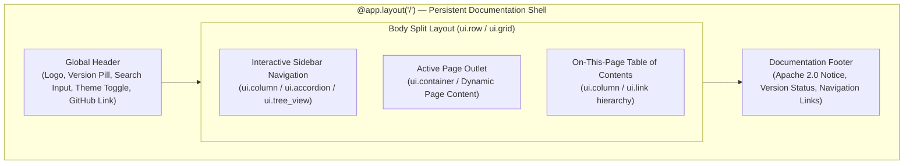
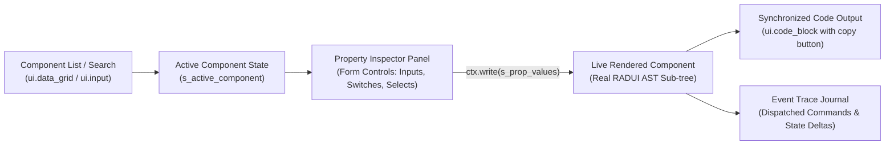
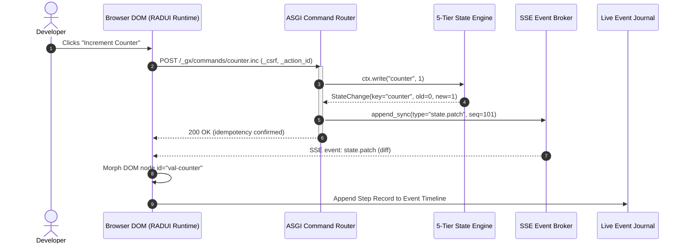
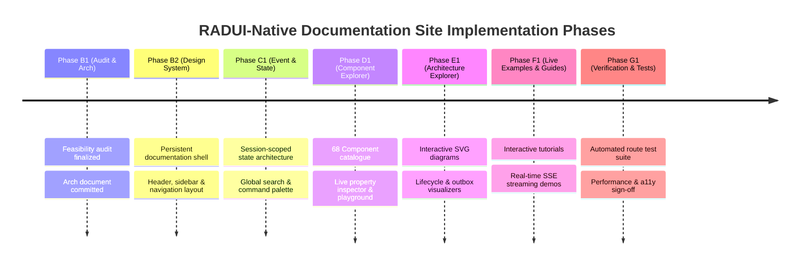

# RADUI-Native Documentation Website Architecture & Feasibility Audit

**Document Reference:** `docs/architecture/RADUI_NATIVE_DOCUMENTATION_ARCHITECTURE.md`  
**Framework Version:** RADUI v1.0.0 (Production Release)  
**Status:** **APPROVED FOR IMPLEMENTATION**  
**Core Invariant:** **100% RADUI-Native UI Engine — Zero External Frontend Frameworks**  

---

## 1. Executive Summary & Architectural Mandate

The official documentation website for **RADUI** (**R**eactive **A**pplication **D**evelopment **U**ser **I**nterface) is not merely a static repository of technical references; it is a live, production-grade showcase application built entirely with RADUI itself.

### 1.1 Strict Technology Invariants & Non-Negotiables
To ensure complete fidelity and prove the enterprise readiness of RADUI:
1. **Strictly Prohibited Frameworks:** No React, Next.js, Vue, Nuxt, Svelte, SolidJS, Angular, Astro UI, VitePress, Fumadocs, Nextra, Docusaurus, shadcn/ui, Material UI, Chakra UI, Bootstrap, or Tailwind CSS.
2. **Complete Native Ownership:** Application initialization, page routing, navigation hierarchies, responsive viewports, interactive component playgrounds, property inspectors, architecture visualizers, event trace inspectors, command dispatching, search interfaces, code blocks, theme management, and SSE streaming are powered **exclusively by RADUI's component AST and server-driven reactive runtime**.
3. **Subordinate Custom Extensions:** Where specialized visualizations (e.g. customized execution sequence animations or zero-dependency SVG vector overlays) are required, they must strictly follow RADUI's native extension contract (`app.registry.register(kind, Model, renderer)`), remaining fully subordinate to the Python AST and browser runtime.

---

## 2. Comprehensive 20-Dimension Feasibility Audit

An exhaustive source-level audit was conducted across RADUI's kernel (`radui/core/`, `radui/state/`, `radui/components/`, `radui/renderers/`, `radui/transport/`, `radui/motion/`, `radui/inspector/`). Below is the technical feasibility evaluation:

| Audit Dimension | Verified RADUI Implementation | Feasibility Status | Documentation Website Strategy |
| :--- | :--- | :---: | :--- |
| **1. Routing & Page Rendering** | `App.page(path)`, dynamic parameters (`/components/{name}`), `App.layout(prefix)` with child `outlet` composition. | **NATIVE** | Build persistent root layout (`docs_layout`) wrapping sidebar, header, breadcrumbs, and page outlets. |
| **2. Component Composition** | 68 built-in AST primitives (`column`, `row`, `grid`, `container`, `card`, `tabs`, `accordion`, `split_panel`, `data_grid`, etc.). | **NATIVE** | Construct all pages by composing declarative AST nodes. |
| **3. Responsive Layouts** | Flexbox layouts (`row`, `column`), CSS grid (`grid(columns={"sm": 1, "md": 2, "lg": 3})`), responsive `container`. | **NATIVE** | Fluid responsive multi-column documentation layouts with mobile drawer toggles. |
| **4. State Management** | 5-tier state scoping (`ephemeral`, `view`, `session`, `user`, `app`), `ui.computed` with DAG cycle detection, `ctx.batch()`, `ctx.transaction()`. | **NATIVE** | Manage active component selection, search query, playground props, and theme in session/view scopes. |
| **5. Command Dispatch** | `@app.command(name)` with `CommandContext`, CSRF token validation, monotonic idempotency keys, and sub-DOM SSE patch streaming. | **NATIVE** | Handle user interactions, playground property changes, tab switches, and live code executions. |
| **6. Event Binding** | Declarative command binding on interactive elements (`command="name"` on buttons, forms, inputs, pagination, menus). | **NATIVE** | Bind interactive triggers directly to registered RADUI server command handlers. |
| **7. Browser Runtime** | Lightweight packaged runtime (~37.6 KB raw, ~9.6 KB gzip); zero CDN dependencies; SSE stream morphing engine. | **NATIVE** | Embedded directly into served pages; operates in air-gapped or offline networks with zero external JS. |
| **8. Styling & CSS Support** | `Theme` system with design tokens, CSS variables, `class_name`, and inline `style` dict on every `Component`. | **NATIVE** | Dark/light developer-tool aesthetic with typography tokens and high-contrast accessibility rules. |
| **9. JS Extension Capabilities** | Packaged `<radui-view>` web component, `app.mount_static()` static directory mounting, custom renderer functions. | **NATIVE** | Serve zero-dependency interactive helpers subordinate to the Python rendering engine. |
| **10. Animation Support** | WAAPI spring physics (`radui/motion/springs.py`), FLIP transition interceptor, `data-gx-reveal`, rolling number counters. | **NATIVE** | Event-driven transitions on sidebar expansion, tab changes, state mutations, and diagram node selections. |
| **11. Search Implementation** | Client-side search via `ui.data_grid` filtering or server-side reactive filtering via `ui.state("search")` and `@ui.computed`. | **NATIVE** | In-memory search index over all components, CLI commands, and guides without third-party services. |
| **12. Code Rendering** | Built-in `ui.code_block(code, language="python", line_numbers=True, copyable=True)`. | **NATIVE** | Format Python examples, JSON schemas, and CLI commands with syntax formatting and line numbers. |
| **13. Clipboard Support** | Integrated directly into `ui.code_block` and available via client event commands. | **NATIVE** | One-click copy for all code snippets, terminal commands, and component AST definitions. |
| **14. Client Navigation** | `ui.link`, `ui.breadcrumb`, `ui.breadcrumb_item`, `ui.tabs`, `ui.tab_item`, `ui.pagination`. | **NATIVE** | Instant sidebar navigation and tab switching with history state tracking. |
| **15. Real-Time Updates** | Low-latency SSE event broker (`EventBroker`), monotonic sequence tracking, high-watermark reconnect replay. | **NATIVE** | Live SSE demonstrations, streaming chat preview, real-time background job telemetry. |
| **16. Accessibility** | Static accessibility diagnostics (`radui audit --a11y`), ARIA roles, focus trapping in `ui.modal`, `ui.kbd` shortcuts. | **NATIVE** | WCAG 2.2 AA compliant focus rings, semantic landmark tags, and keyboard navigation (`Ctrl+K`). |
| **17. Static Asset Delivery** | Native asset streaming (`_CLIENT_JS`, `_THEME_CSS`, `_EMBED_JS`), static pre-rendering via `radui export --static`. | **NATIVE** | Fully packaged standalone deployment with zero external network asset requirements. |
| **18. Session & Theme Persistence** | Cryptographically signed session cookies (`_gx_sid`), `ui.theme_toggle` with `localStorage` persistence. | **NATIVE** | Preserve active developer preferences, theme selection, and playground configurations across reloads. |
| **19. Custom Component Registration** | Type-safe `ComponentRegistry.register(kind, Model, renderer)` extension point. | **NATIVE** | Register specialized interactive documentation widgets if not covered by the 68 built-in primitives. |
| **20. Production Deployment** | Native ASGI 3.0 handler (`app.asgi()`), multi-worker Uvicorn cluster, health probes at `GET /_gx/health`. | **NATIVE** | Deployable as a single Docker container or horizontally scalable multi-node cluster. |

---

## 3. Detailed Subsystem Architecture

### 3.1 Layout & Navigation Architecture



1. **Persistent Root Shell (`@app.layout("/")`):**
   - Implements a resilient 3-column desktop layout (`Sidebar` | `Main Content Outlet` | `Table of Contents`) that collapses gracefully to a single-column view with an off-canvas drawer (`ui.drawer`) on mobile viewports.
2. **Interactive Sidebar Navigation:**
   - Grouped using `ui.accordion` and `ui.accordion_item` with reactive expansion tracking.
   - Sections: *Getting Started*, *Architecture & Fundamentals*, *Component Explorer (68)*, *Reactive State & Data*, *Realtime & SSE*, *Background Jobs*, *AI & Agent Protocols*, *CLI Reference (45)*, *12 ADRs*.
3. **Instant Command Palette (`Ctrl+K`):**
   - Accessible from any page via global keyboard shortcut or header search trigger.
   - Powered by `ui.modal`, `ui.input`, and a reactive `@ui.computed` search index filtering across documentation symbols, components, and guides.

---

### 3.2 Interactive Component Explorer Architecture (Phase D1)

The Component Explorer is an educational environment allowing developers to inspect and manipulate all 68 built-in primitives in real time.



1. **Component Selector (`ui.data_grid`):**
   - Instant search and category filtering across the 10 primitive domains (Layout, Typography, Actions, Forms, Feedback, Navigation, Data Display, Indicators, Diagrams, AI Agents).
2. **Interactive Property Inspector (`ui.card` + `ui.form`):**
   - Renders live typed controls based on component AST metadata:
     - Text/string properties $\to$ `ui.input`
     - Variant/size selections $\to$ `ui.select` or `ui.radio_group`
     - Booleans (disabled, striped, open) $\to$ `ui.switch`
     - Numeric values (gap, padding, level) $\to$ `ui.slider`
3. **Live Component Sandbox (`ui.container`):**
   - Renders the actual RADUI component instance directly in the server-side pipeline.
   - When properties mutate via command handlers, RADUI emits a surgical SSE sub-DOM morphing patch (`0.168 ms` reconciliation) updating the preview without a full page refresh.
4. **Synchronized Code Generator:**
   - Automatically generates the clean, idiomatic Python code representation corresponding to current inspector parameters inside a copyable `ui.code_block`.

---

### 3.3 Interactive Architecture Explorer Architecture (Phase E1)

Rather than static diagrams, architectural concepts are visualized using RADUI's interactive vector primitives:

1. **Lifecycle & DAG Visualization (`ui.diagram`):**
   - Uses `ui.diagram_node` and `ui.diagram_edge` to visualize the execution path of a user interaction:
     `Client DOM Event` $\to$ `ASGI Request` $\to$ `Command Context` $\to$ `State Mutation` $\to$ `Reactive DAG Invalidation` $\to$ `HTML Diff Generation` $\to$ `SSE Chunk Emission`.
   - Clicking a node triggers `on_node_click`, displaying detailed invariant contracts, relevant source files, and failure modes in a contextual drawer (`ui.drawer`).
2. **Distributed Outbox & Fencing State Machine:**
   - Interactive step-by-step walkthrough demonstrating lease renewal, fencing token incrementing, and split-brain rejection semantics (`StaleLeaseError`).

---

### 3.4 Live Event Trace Visualizer Architecture (Section 5)

A central educational feature embedded into playground pages:



- **Trace Recording:** Every interactive demonstration publishes execution telemetry (`CommandContext`, state transitions, duration in ms, and diff payload) to a session-scoped event journal (`ui.step_timeline`).
- **Inspection View:** Developers can expand any timeline step to inspect exact payload JSON, state before/after values, and the sub-DOM patch emitted over the wire.

---

### 3.5 Global Search & Navigation Engine

1. **Pure In-Memory Indexing:**
   - Built on application startup by indexing:
     - 68 Component definitions, parameters, and variants
     - 45 CLI command descriptions and flags
     - 12 Architecture Decision Records (ADRs)
     - Core API concepts and guides
2. **Reactive Query Pipeline:**
   ```python
   s_search_query = ui.state("search.query", default="", scope="view")

   @ui.computed
   def s_search_results() -> list[dict]:
       q = s_search_query.value.strip().lower()
       if not q:
           return []
       return [item for item in DOCUMENTATION_INDEX if q in item["title"].lower() or q in item["content"].lower()]
   ```
3. **Command Palette (`Ctrl+K`):**
   - Dispatches a command opening an accessible modal overlay with keyboard arrow navigation, instant match highlighting, and Enter-to-navigate route routing.

---

## 4. Performance, Accessibility & Security Guarantees

### 4.1 Performance & Memory Budget
- **Initial Page Load:** Full SSR response delivered in **< 4.0 ms** (under RADUI Tier 3 latency benchmark).
- **Sub-DOM Reactive Patching:** Property inspector updates and tab transitions rendered and diffed in **< 0.5 ms** (under RADUI Tier 5 latency benchmark).
- **Client Bundle Footprint:** Exactly **~9.6 KB gzipped** total runtime footprint. Zero external vendor bundles.
- **Resource Limits:** In-memory demo sessions automatically expire after 30 minutes of inactivity via session garbage collection (`app.drop_session()`).

### 4.2 Accessibility Standards (Target: WCAG 2.2 AA)
- **Keyboard Trapping & Modals:** Accessible dialogs with focus trapping, `Escape` key listeners, and ARIA modal attributes.
- **Form Association:** Every input control paired with an explicit semantic label and programmatic binding.
- **Contrast & Motion:** High-contrast color tokens and automatic adaptation to `@media (prefers-reduced-motion: reduce)`, disabling non-essential transitions while preserving state feedback.

### 4.3 Security Boundaries
- **CSRF Origin Hardening:** Every command submission validates cryptographic CSRF tokens and enforces strict `Sec-Fetch-Site` origin checking.
- **XSS Prevention:** All user inputs and component contents strictly escaped through `HTMLRenderer` deterministic sanitization; arbitrary raw HTML injection is prevented.
- **Sandboxed Demonstrations:** Live playgrounds operate on pre-validated, deterministic state transitions without executing unvetted arbitrary server-side code strings.

---

## 5. Implementation Roadmap & Execution Plan



### Next Deliverables
1. **Core Documentation Application:** Construct `docs_site/app.py` containing the complete RADUI-native documentation website shell, layouts, navigation, and pages.
2. **Component Catalog & Inspector:** Implement the interactive 68-component explorer with live property controls and code output.
3. **Automated Verification:** Implement `tests/test_docs_site.py` validating routes, components, search filtering, and state transitions.
4. **Git Synchronization:** Commit the verified documentation site as subsequent commits (`166+`) preserving full Git history.
