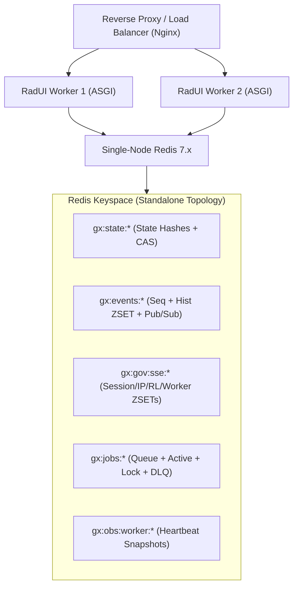
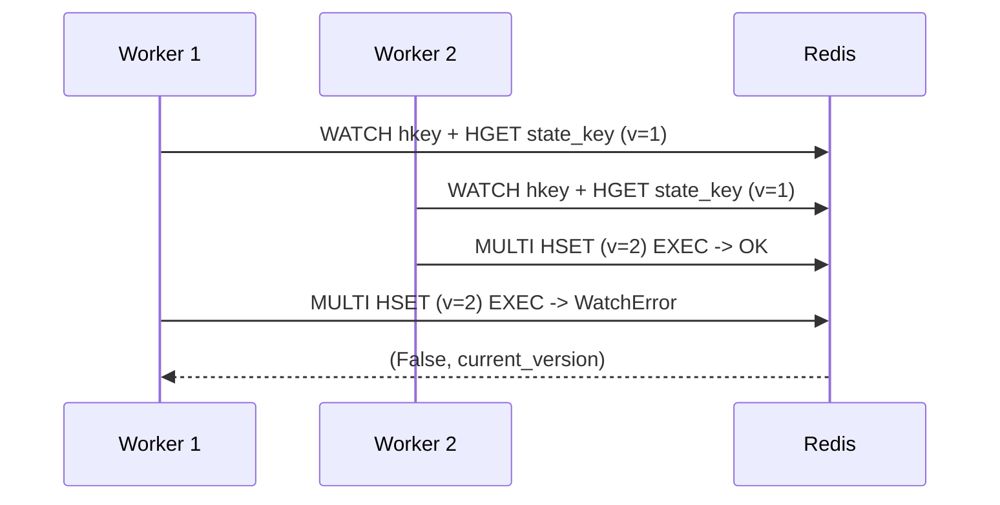
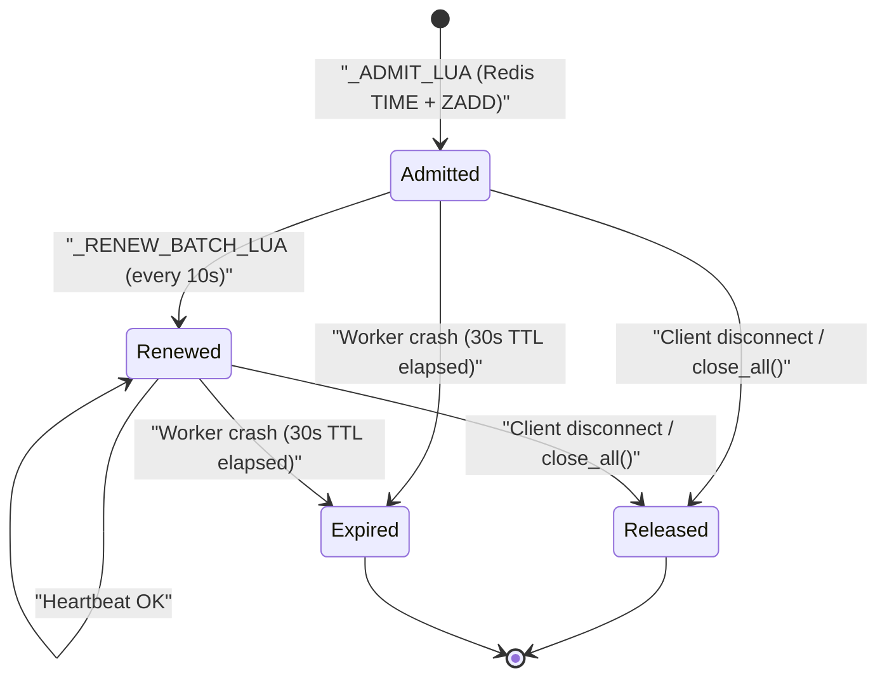
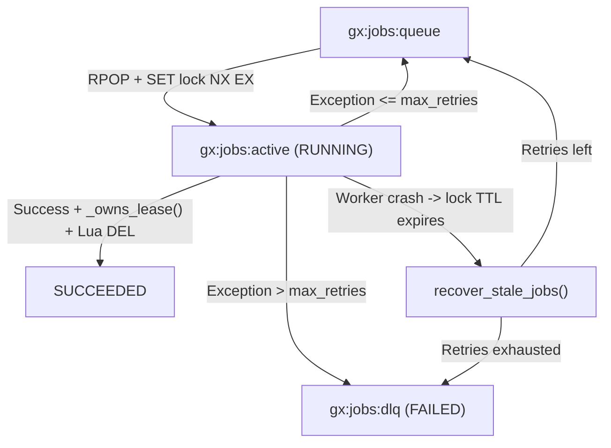
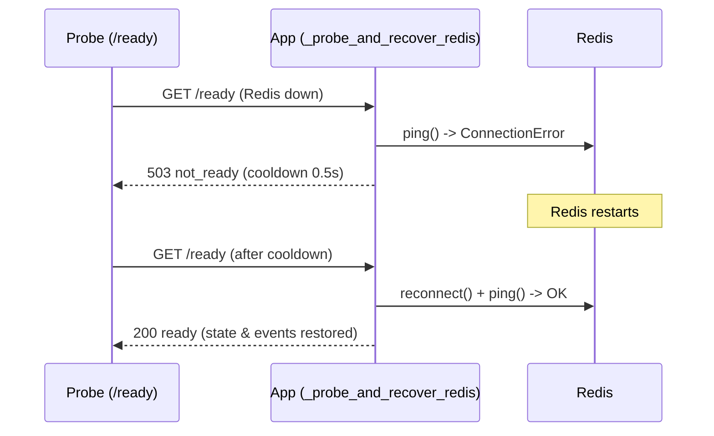

# RadUI Distributed Runtime & Backend Architecture

RadUI separates runtime coordination behind pluggable backend abstractions so applications can run single-process (`memory` or `sqlite`) or multi-worker (`redis`) without changing application handlers.

## 1. Single-Process vs. Multi-Worker Architecture

| Subsystem | `RADUI_BACKEND=memory` / `sqlite` | `RADUI_BACKEND=redis` |
|---|---|---|
| **State (`StateBackend`)** | `InMemoryStateBackend` (process-local) or `SQLiteStateBackend` (single-node WAL) | `RedisStateBackend` (shared hash keys, `WATCH`/`MULTI`/`EXEC` CAS, optional TTL) |
| **Events (`EventBackend` + `EventBroker`)** | Process-local `InMemoryEventBackend` or `SQLiteEventBackend` | `RedisEventBackend` (bounded SortedSet history + Redis Pub/Sub cross-worker fan-out) |
| **SSE Governance (`SSEGovernanceBackend`)** | `InMemorySSEGovernance` (process-local `RLock`) | `RedisSSEGovernance` (atomic Lua + Redis server `TIME` leases + sliding-window rate limit) |
| **Jobs (`JobBackend`)** | `LocalJobBackend` or `SQLiteJobBackend` | `RedisJobBackend` (Redis list queue, `SET NX EX` claim lock, Lua release, `recover_stale_jobs()`, DLQ) |
| **Idempotency (`IdempotencyBackend`)** | `InMemoryIdempotencyBackend` (default on `App` unless `RedisIdempotencyBackend` passed) | `RedisIdempotencyBackend` (Lua fencing-token enforcement) |
| **Observability** | Local `observability_snapshot()` only | `WorkerObservabilityPublisher` (`gx:obs:worker:*` TTL snapshots + cluster aggregation) |



---

## 2. Redis-Backed State Synchronization & CAS

`RedisStateBackend` (`radui/state/backend.py`) stores JSON envelopes (`{"v": version, "d": value}`, `allow_nan=False`) in Redis hashes (`{prefix}{scope}:{identity_key}`).
- **Optimistic Concurrency:** `compare_and_set()` uses `WATCH` -> `HGET` -> version check -> `MULTI`/`HSET`/`EXPIRE`/`EXEC`. Version mismatches or `WatchError` return `(False, current_version)` and increment `cas_conflicts`.
- **Fail-Closed Behavior:** When `allow_fallback=False` (enforced by `App` when `RADUI_BACKEND=redis`), Redis unavailability raises `StateBackendUnavailableError` rather than silently falling back to process-local memory (preventing cluster split-brain).



---

## 3. Event Publication, Pub/Sub & Bounded Replay

`RedisEventBackend` (`radui/transport/events.py`) combines durable bounded history with live Pub/Sub fan-out:
1. `append_sync()` increments `{prefix}seq:{session_id}`, writes the event to `{prefix}hist:{session_id}` (`ZADD`), trims to `history_size` (`ZREMRANGEBYRANK`, default `128`), and publishes to `{prefix}pub:{session_id}`.
2. `EventBroker.stream(session_id, last_event_id=...)` subscribes to `subscribe_remote()` **before** capturing `high_watermark = current_sequence(session_id)`, replays `(last_event_id, high_watermark]` from the SortedSet, and deduplicates live frames with `sequence <= delivered_sequence`.
3. If `last_event_id` is older than the retained `history_size` window (`replayed_events[0].sequence > last_event_id + 1`) or `last_event_id > high_watermark`, RadUI emits `event: reset` and increments `replay_gaps` / `resets_sent`.

```mermaid
sequenceDiagram
    participant C as Browser SSE
    participant W as Worker
    participant R as Redis
    C->>W: GET /_gx/events (Last-Event-ID: 5)
    W->>R: SUBSCRIBE gx:events:pub:sess
    W->>R: GET gx:events:seq:sess (HWM=8)
    W->>R: ZRANGEBYSCORE hist (5..8]
    W-->>C: Replay events 6, 7, 8
    R-->>W: Pub/Sub message (seq=8, 9)
    W-->>C: Deduplicate seq 8; deliver seq 9
```

---

## 4. Distributed SSE Admission Governance & Worker Leases

`RedisSSEGovernance` (`radui/transport/governance.py`) enforces global limits across all workers using atomic Lua scripts and **Redis server `TIME`** (avoiding worker clock skew):
- **Atomic Admission (`_ADMIT_LUA`):**
  1. Computes `now_ms` from `redis.call('TIME')` and `exp_ms = now_ms + lease_ttl_ms`.
  2. Checks/updates sliding-window rate limit (`{prefix}rl:...`).
  3. Prunes expired members (`ZREMRANGEBYSCORE ... -inf now_ms`) and checks `max_connections_per_session` (`{prefix}session:{session_id}`) and `max_connections_per_ip` (`{prefix}ip:{client_ip}`).
  4. Adds `{worker_id}:{conn_id}` to session, IP, and worker-owned (`{prefix}worker:{worker_id}`) ZSETs.
- **Bounded Lease Renewal (`_RENEW_BATCH_LUA`):** The worker's `run_governance_renewal_loop` renews owned connections in batches of 50 every `sse_heartbeat_interval_seconds` (`10s` default).
- **Crash & Shutdown Cleanup:** Graceful shutdown (`EventBroker.close_all()`) calls `release_all()` to free slots immediately. Crashed workers' slots expire automatically once `lease_ttl_seconds` (`30s` default) passes.
- **Failure Policy:** Fails closed (`503`) by default (`RADUI_SSE_GOVERNANCE_FAIL_OPEN=false`).



---

## 5. Distributed Job Queue, Fencing & Crash Recovery

`RedisJobBackend` (`radui/jobs/redis.py`) coordinates background jobs across workers:
- **Enqueue (`submit`):** Validates JSON (`allow_nan=False`), optionally enforces `idempotency_key` (`SET NX EX 86400`), persists job JSON, and pushes `job_id` to `{prefix}queue`.
- **Claim & Execution:** `process_once()` pops a job ID, acquires `{prefix}lock:{job_id}` (`SET ... {worker_id} NX EX lease_ttl_seconds`), and adds `job_id` to `{prefix}active`. Before saving `SUCCEEDED`, `_owns_lease(job_id)` verifies the worker still holds the lock; `finally` releases the lock with an atomic compare-and-delete Lua script so a stale worker never deletes a newer worker's lock.
- **Retries & DLQ:** Failed or timed-out jobs re-queue up to `max_retries`, then transition to `FAILED` and push to `{prefix}dlq`.
- **Orphaned Job Recovery:** `recover_stale_jobs()` scans `{prefix}active`, claims a short `{prefix}rec:{jid}` lock for any `RUNNING` job whose `{prefix}lock:{jid}` expired, and re-enqueues it (or marks `FAILED` if retries are exhausted).
- **Idempotency & Fencing (`RedisIdempotencyBackend`):** Uses monotonic per-key fence tokens (`Lua`) rejecting stale workers (`fence_token < current_fence_token`) while treating token `0` as valid.



---

## 6. Readiness, Liveness & Redis Outage Recovery

- **`GET /health` (and `/_gx/health`):** Process liveness probe. Returns `200` unless `app` is shutting down (`503 {"status": "draining"}`). Does **not** fail merely because Redis is unavailable.
- **`GET /ready`:** Readiness probe. Returns `503` during startup/shutdown, if any user-defined `add_readiness_check()` fails, or (for `RADUI_BACKEND=redis`) if `_default_redis_readiness_check` fails.
- **Bounded Reconnection:** When Redis restarts after an outage, `_probe_and_recover_redis()` (triggered by `/ready` off the event loop via `asyncio.to_thread`) performs a single cooldown-protected (`0.5s` default) `reconnect()` on any backend whose `ping()` failed (including restoring cleared `_client = None` references), returning `200` once `state_runtime.backend`, `events.backend`, and `jobs` are healthy.
- **Existing SSE Streams After Outage:** `subscribe_remote()`'s reader thread exits when its Pub/Sub socket drops and does **not** automatically re-subscribe; existing SSE streams continue receiving missed events via `EventBroker.stream()`'s `keepalive_seconds` replay reconciliation once Redis recovers, and full live Pub/Sub push resumes when clients reconnect SSE.



---

## 7. Explicit Delivery Guarantees & Unsupported Topologies

- **Redis Pub/Sub:** **At-most-once** for live delivery; disconnected subscribers rely on `Last-Event-ID` replay.
- **Event Replay:** **Bounded** by `history_size` (`128` events per session by default). Older gaps emit `event: reset`.
- **Job Execution:** **At-least-once** across worker crashes and lease expirations. **All job handlers MUST be idempotent.**
- **Redis Cluster:** **Unsupported.** Multi-key Lua scripts in `RedisSSEGovernance` and `SCAN`/`MGET` worker discovery in `collect_cluster_snapshot()` assume a single-node/non-sharded Redis keyspace.
- **PostgreSQL Event Backend:** **Not implemented.** `PostgreSQLEventBackend` raises `NotImplementedError` on `postgres://` / `postgresql://` DSNs.

See also: [Production Deployment Guide](production.md) and [Observability & Diagnostics](observability.md).
