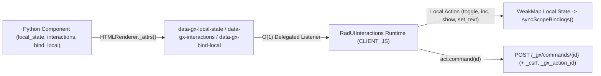

# RadUI Declarative Client-Side Interaction Engine (M1.8)

RadUI's interaction engine lets Python developers declare fast, local browser interactions on any component without writing JavaScript, without `eval`/`Function`, and without Node.js or external frontend frameworks.

## 1. Architecture & State Separation

RadUI strictly separates **browser-local transient state** from **authoritative Python state**:
- **Local Transient State (`local_state` + `bind_local`):** Stored per component in a browser `WeakMap` (automatic garbage collection when DOM nodes are removed) and updated via `O(1)` delegated listeners on `document`. Executes in sub-millisecond time with zero HTTP requests.
- **Authoritative Server State (`StateRef` + `@app.command`):** Remains in Python (`StateRuntime` / Redis) and is mutated only via CSRF-protected `POST /_gx/commands/{command_id}` requests.



---

## 2. Public Python API (`radui.interactions`)

Exported directly from `radui` (`gx.on`, `gx.act`, `gx.InteractionBinding`, `gx.InteractionAction`):

```python
import radui as gx

counter = gx.column(
    gx.text("0", id="cnt", bind_local={"text": "count"}),
    gx.text("Details", id="panel", bind_local={"visible": "open"}),
    gx.button("+", id="inc", interactions=(gx.on("click", gx.act.increment("count", by=1), gx.act.announce("Incremented")),)),
    gx.button("Details", id="tog", interactions=(gx.on("click", gx.act.toggle("open")),)),
    id="counter-scope",
    local_state={"count": 0, "open": False},
)
```

### Supported Events (`on(event, *actions, key=None, prevent_default=False, stop_propagation=False)`)
`click`, `dblclick`, `mouseenter`, `mouseleave`, `pointerenter`, `pointerleave`, `focus`, `blur`, `input`, `change`, `keydown`, `keyup`, `submit`, `dragstart`, `dragover`, `drop`.
- Keyboard filtering (`key="Escape"`, `key="ArrowRight"`, `key="ctrl+k"`) is supported on `keydown` and `keyup`.

### Allowlisted Actions (`gx.act.*`)
- **Local State:** `toggle(key, target=None)`, `set(key, value, target=None)`, `increment(key, by=1, target=None)`, `decrement(key, by=1, target=None)`
- **Visibility & Open State:** `show(target=None)`, `hide(target=None)`, `open(target=None)`, `close(target=None)`
- **Enabled State:** `enable(target=None)`, `disable(target=None)`
- **DOM & Classes:** `add_class(cls, target=None)`, `remove_class(cls, target=None)`, `toggle_class(cls, target=None)`, `set_text(text, target=None)`, `set_attr(attr, value, target=None)`, `remove_attr(attr, target=None)`
- **Accessibility & Server Bridge:** `announce(message)` (writes to `#gx-live-region`), `focus(target)`, `command(command_id)` (dispatches CSRF-protected `/_gx/commands/{command_id}`)

### Local Reactive Bindings (`bind_local`)
Supported properties on any component: `text`, `visible`, `hidden`, `disabled`, `open`, `pressed` (`aria-pressed`), `expanded` (`aria-expanded`).

---

## 3. Accessibility & Security Model

- **Accessibility:**
  - `Tabs` emits `role="tablist"`, `role="tab"`, `aria-selected`, `role="tabpanel"`, `hidden`, and supports `ArrowLeft`/`ArrowRight`/`Home`/`End` keyboard navigation.
  - `Modal` emits `role="dialog"`, `aria-modal="true"`, `aria-hidden`, focus trapping, `Escape` close, and focus restoration.
  - `Drawer` emits `aria-expanded`, `aria-hidden`, focus placement, `Escape` close, and focus restoration.
  - `DropdownMenu` and `Popover` close on `Escape` and restore focus to `<summary>`.
  - `act.announce(...)` updates a polite `aria-live="polite"` region (`#gx-live-region`).
- **Security:**
  - Zero `eval`, `new Function`, or inline `on*` execution.
  - `set_text` writes `textContent` only (never `innerHTML`).
  - `set_attr`/`remove_attr` reject `on*`, `src`, `href`, `style`, and `innerHTML`, allowing only safe ARIA/state/form attributes (`aria-*`, `data-gx-state-*`, `hidden`, `disabled`, `title`, `placeholder`, `tabindex`, `role`).
  - `act.command(...)` enforces `_csrf`, `_gx_action_id`, `_gx_view_id`, and page-level command authorization in `_command_endpoint`.

---

## 4. Performance, Runtime Budget & Migration Guidance

- **Runtime Bundle Budget (`CLIENT_JS`):**
  - **Raw UTF-8:** `69,187 B` (`67.57 KiB`)
  - **Gzip (level 9):** `16,189 B` (`15.81 KiB`)
  - **Brotli:** Not measured (optional `brotli` Python package is not installed in the verification environment)
  - **Budget Target:** Keep `CLIENT_JS` `< 20 KiB` gzipped (`< 75 KiB` raw) with zero external JS dependencies.
- **Measured Headless Chrome Performance (500-interaction benchmark):**
  - **p50 latency:** `0.200 ms`
  - **p95 latency:** `0.400 ms`
  - **100-cycle dynamic mount/unmount stress:** `100/100` cycles passed with `WeakMap` state, single-init global delegation (`__gxInteractionsBootstrapped`), and zero HTTP round trips.
- **Component Builder Coverage:**
  - **71 / 71** public `Component`-returning builders in `radui/components/nodes.py` accept `local_state`, `interactions`, and `bind_local`.
  - **70 / 71** emit `data-gx-local-state`, `data-gx-interactions`, and `data-gx-bind-local` directly in standalone HTML rendering (`tab_item` is a structural sub-item rendered inside `Tabs`).
- **SSR, SSE & Hybrid Islands Compatibility:**
  - `applyPatches` (SSE updates) and `activateIsland` (`/_gx/islands/{id}`) invoke `window.RadUIInteractions.syncTree(...)` synchronously upon DOM insertion in addition to `MutationObserver` coverage.
- **Migrating from Server-Only Toggles:** Replace purely visual UI toggles (panels, tabs, local counters, class toggles) with `local_state` + `on("click", act.toggle(...))`, reserving `@app.command` for authoritative backend mutations.
