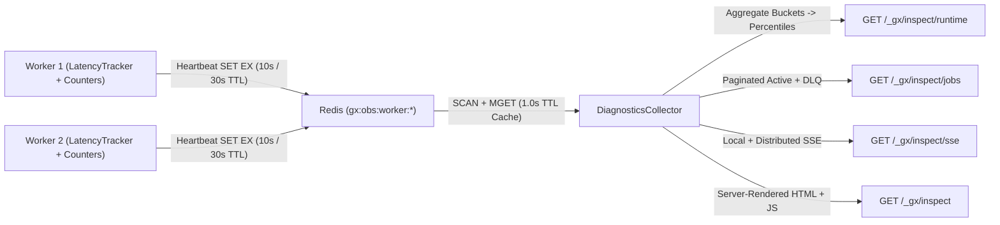

# RadUI Observability & Runtime Diagnostics Guide

RadUI provides built-in, dependency-free observability and runtime diagnostics across state, events, SSE governance, and background jobs without requiring Prometheus, OpenTelemetry collectors, or Node.js frontend tooling.

## 1. Observability Architecture

Each RadUI worker maintains bounded in-process counters and rolling latency histograms (`LatencyTracker`) and publishes compact JSON snapshots to Redis on a periodic heartbeat (`WorkerObservabilityPublisher`). Diagnostic endpoints (`/_gx/inspect/*`) aggregate active worker snapshots across the cluster on demand behind a short TTL cache (`1.0s` default in `DiagnosticsCollector`).

### Non-Recursive Collection & Failure Isolation
- `_collect_worker_observability()` reads in-memory backend counters directly without invoking `StateRuntime` or `EventBroker.publish()`, preventing recursive telemetry loops.
- Redis failures during `publish_snapshot()` increment `publish_errors` and return `False` without crashing request handling or background jobs.
- Snapshots exceeding `MAX_SNAPSHOT_BYTES` (`32,768` bytes) are dropped safely.
- Raw session IDs, client IPs, state values, job arguments/results, `RADUI_SESSION_SECRET`, and Redis credentials are never included in snapshots or diagnostic responses.

---

## 2. Worker Identity & Heartbeat Snapshots

`WorkerIdentity` (`radui/observability.py`) standardizes worker identity across `App`, `EventBroker`, `RedisSSEGovernance`, and `RedisJobBackend`:

| Field | Description |
|---|---|
| `worker_id` | Unique worker identifier (`worker-<hex>`), shared across all subsystems |
| `hostname` | Host machine name (`socket.gethostname()`) |
| `pid` | OS process ID (`os.getpid()`) |
| `started_at` | UTC ISO-8601 startup timestamp |
| `environment` | `RADUI_ENV` value (`development`, `testing`, `staging`, `production`) |
| `backend_mode` | `RADUI_BACKEND` value (`memory`, `sqlite`, `redis`) |

- **Startup:** Registered in Redis at `{prefix}obs:worker:{worker_id}` (`prefix` default: `gx:obs:worker:`) with TTL `sse_lease_ttl_seconds` (`30s` default).
- **Heartbeat:** Republished every `sse_heartbeat_interval_seconds` (`10s` default) via `_run_observability_heartbeat`.
- **Graceful Shutdown:** `deregister()` deletes the worker key immediately during `lifespan` teardown.
- **Crash Expiration:** Crashed workers automatically disappear when their Redis key TTL expires.
- **Stale Detection:** `DiagnosticsCollector` marks a worker `"stale"` if `snapshot_age_seconds > max(5.0, sse_heartbeat_interval_seconds * 2.5)` (`25s` by default).

---

## 3. Latency Histograms & Cluster Percentile Aggregation

`LatencyTracker` (`radui/observability.py`) uses:
- A bounded ring buffer (`collections.deque(maxlen=512)` by default) for local `p50_ms` and `p95_ms` calculation (computed only on `snapshot()`, never on `record()`).
- Fixed histogram buckets: `<1ms`, `<5ms`, `<20ms`, `<100ms`, `<500ms`, `>=500ms`.
- Total `count`, `errors`, and `max_ms`.

### Why Cluster Percentiles Are Calculated From Aggregated Histogram Buckets
Averaging per-worker `p95_ms` values is mathematically invalid when workers handle skewed traffic volumes or latency distributions. For example, if Worker A handles 100 requests at `0.5ms` (`p95 = 0.9ms`) and Worker B handles 10 requests at `800ms` (`p95 = 800ms`), averaging worker percentiles yields `~400ms`, whereas the true cluster p95 (rank 104.5 of 110 total requests) lies in the `>=500ms` bucket.

`aggregate_latency_histograms()` sums bucket counts across all active workers first and interpolates cluster `p50_ms` and `p95_ms` from the combined histogram.

---

## 4. Subsystem Metrics Reference

### State Backend (`RedisStateBackend.observability_snapshot()`)
- **Operations:** `get`, `set`, `cas`, `cas_conflicts`, `delete`, `ttl_writes`, `backend_errors`.
- **Latencies:** `get`, `set`, `cas`, `delete`.
- **TTL Expiration Limitation:** `ttl_writes` counts writes configured with an expiry. Actual Redis-side key expiration counts are **not** tracked (would require Redis keyspace notifications), and `/_gx/inspect/runtime` explicitly reports `state.ttl_expirations.available = false` rather than substituting `ttl_writes`.

### Event Backend & Broker (`RedisEventBackend` / `EventBroker.observability_snapshot()`)
- **Operations:** `published`, `replayed`, `replay_calls`, `pubsub_delivered`, `replay_gaps`, `resets_sent`, `queue_overflows`, `events_delivered`, `backend_errors`.
- **Latencies:** `publish`, `replay`.

### SSE Governance (`RedisSSEGovernance.observability_snapshot()`)
- **Operations:** `admitted`, `rejected_rate_limit`, `rejected_session_limit`, `rejected_ip_limit`, `rejected_worker_capacity`, `rejected_backend_unavailable`, `leases_renewed`, `expired_leases`, `renewal_failures`, `backend_errors`.
- **Latencies:** `admit`.

### Job Backend (`RedisJobBackend.observability_snapshot()`)
- **Gauges:** `queue_depth`, `active_count`, `dlq_depth` (shared cluster gauges queried on snapshot, aggregated via `max` across workers rather than summed).
- **Operations:** `enqueue`, `claim`, `complete`, `fail`, `retry`, `dlq`, `stale_recovered`, `backend_errors`.
- **Latencies:** `enqueue`, `claim`, `execution`.

---

## 5. Diagnostic Endpoints & Inspector Dashboard

All `/_gx/inspect*` routes share centralized authorization (`App._authorize_inspector()`):
- **Production default:** Disabled (`404 Not Found`) unless `RADUI_INSPECTOR_ENABLED=true` (or `inspector_enabled=True`).
- **Authentication & RBAC:** Requires a valid signed session (`401`), authenticated user (`401`), and `admin` role, `inspector` role, `inspect:*` permission, or custom `inspector_authorizer` (`403`).
- **Local Dev Exception:** Allowed without auth only when `environment == "development"`, `debug=True`, and neither `user_resolver` nor `inspector_authorizer` is configured.

| Endpoint | Purpose | Bounds & Safety |
|---|---|---|
| `GET /_gx/inspect/runtime` | Cluster status (`healthy`/`degraded`/`unavailable`), warnings, Redis `ping_ms`, worker roster, aggregated metrics & percentiles | Max 100 workers; `1.0s` TTL cache; `None` vs `0` distinction |
| `GET /_gx/inspect/jobs` | Queue/active/DLQ depths, active owner & lease TTL, DLQ `error_type` summary | `limit` clamped `[1, 100]`, `offset >= 0`; excludes `args`, `kwargs`, `result`, `session_id` |
| `GET /_gx/inspect/sse` | Backward-compatible 11-key `metrics` + `local` hashed `session_groups` + `governance` state | Session IDs SHA-256 truncated to 12 chars, top 20 groups |
| `GET /_gx/inspect` | Server-rendered HTML dashboard with manual **Refresh Now** button, **Auto-refresh** toggle (`5s`/`10s`/`30s`), Worker Roster, SSE Governance, Latency Table, Active Jobs/DLQ, SVG DAG, and Traces | Zero external JS/CSS/CDN dependencies |
| `GET /_gx/inspect/config` | Redacted `RadUIConfig.safe_summary()` | Secrets masked as `***REDACTED***` |
| `GET /_gx/inspect/backends` | Local backend `metrics()` summary | Integer counters only |
| `GET /_gx/inspect/traces`, `/stats`, `/dag` | Execution trace records, counts, and reactive dependency SVG/JSON | Trace limit capped at 500 |

### Unavailable vs. Zero Semantics
When Redis is unreachable, `cluster.available` and `jobs.available` are `false`, `redis.connected` is `false`, `status` is `"unavailable"`, and unavailable gauges (`queue_depth`, `active_count`, `dlq_depth`, `ping_ms`) are `null` (`None`) rather than `0`.

For troubleshooting steps, see [Observability & Diagnostics Runbook](operations/observability-diagnostics.md).
